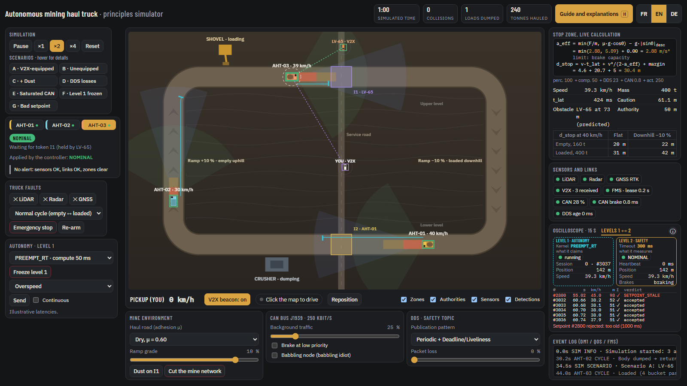

# aht-safety-poc

An interactive, single-page simulator that shows how an **Autonomous Haul Truck (AHT)** in an open-pit mine stays safe in mixed traffic: braking envelopes, fleet-management movement authority, CAN bus arbitration, DDS quality of service and an independent safety supervisor.

It is a teaching proof of concept. The physics is simplified but consistent: every number on screen is computed by the model.

**Live demo:** [bretzelcoder.github.io/aht-safety-poc](https://bretzelcoder.github.io/aht-safety-poc/) ([English](https://bretzelcoder.github.io/aht-safety-poc/?lang=en), [Deutsch](https://bretzelcoder.github.io/aht-safety-poc/?lang=de))



> The user interface is available in French (default), English and German. Switch with the **FR / EN / DE** buttons in the header or with `?lang=en` / `?lang=de` in the URL; the choice is remembered in the browser. Technical terms, supervisor states, fault codes, DDS QoS names and standard references stay unchanged in every language. An in-app guide (button **Guide and explanations** or key **H**) explains every panel.

## Run it

No build, no dependencies. Use the [live demo](https://bretzelcoder.github.io/aht-safety-poc/), open `index.html` in a recent browser, or serve your own copy with GitHub Pages (Settings → Pages → deploy from branch `main`, folder `/`). Only the [automated checks](#automated-checks) need anything installed, and the page never loads it.

The page loads Google Fonts if online and falls back to system fonts otherwise.

### Analytics

The live demo counts visits with [GoatCounter](https://www.goatcounter.com/), a privacy-friendly service: no cookies, no personal data, aggregated statistics only (page views, referrer, country, browser, screen size). It also records a few anonymous events: the language shown at start and language switches, the scenarios launched and the guide being opened. Tracking only runs on the GitHub Pages site; a local copy of `index.html` loads nothing. To credit a shared link, add `?ref=<source>` to it (for example `?ref=linkedin`): GoatCounter shows it as the referrer.

## What you can explore

| Topic | What the simulator shows |
|---|---|
| Braking envelope | Each truck projects an amber caution zone and a red SIL stop zone along its path, recomputed every 20 ms from speed, mass, grade, road adhesion and latency. |
| Mass effect | Empty, the truck is adhesion-limited and mass cancels out; loaded, it is brake-capacity-limited. Loaded and downhill is the sizing case. |
| Movement authority | The fleet management system (FMS) grants each truck a stretch of road and intersection tokens. A truck never drives beyond its authority. |
| Mixed traffic | You drive a maintenance pickup (ZQSD or arrow keys), with or without a V2X beacon, and cut in front of the trucks. |
| Fail-operational | With the LiDAR blinded by dust, the truck falls back on radar and continues at 15 km/h. |
| CAN bus (J1939) | Priority arbitration keeps a well-prioritised brake command fast under load; a mis-prioritised one misses its deadline, then trips the brake ECU watchdog. |
| DDS QoS | Periodic state with Deadline and Liveliness versus event-driven RELIABLE or BEST_EFFORT, under packet loss. |
| Safety supervisor | State machine `NOMINAL` → `DEGRADED_SPEED` → `CONTROLLED_STOP` → `EMERGENCY_BRAKE` (latched until acknowledged), with the state actually applied by the motion controller shown separately. |

### Built-in scenarios

| | Scenario | Expected outcome |
|---|---|---|
| A | Pickup **with** V2X crosses intersection I1 | The FMS revokes the truck's I1 token; the truck makes a planned stop before the intersection. |
| B | Pickup **without** V2X crosses I1 | Only on-board perception protects; trajectory prediction slows the truck early. |
| C | B inside a dust cloud | LiDAR lost, radar fallback, degraded speed, mission continues. |
| D | Stop command sent once in BEST_EFFORT with 50 % loss | The order is lost silently in most runs and a collision follows in a sizeable share of them, so replay several times. Switch to periodic publishing to compare. |
| E | Saturated CAN bus, brake command mis-prioritised | Deadline missed → controlled stop; push the load towards 90 % → watchdog → emergency brake. |

## Modelling choices

- **Stopping distance:** `d_stop = v·t_lat + v² / (2·a_eff) + margin`, with `a_eff = min(F_brake/m, μ·g·cosθ) − g·sinθ`. Keeping the two limits separate is what makes mass matter.
- **Stop zone and braking:** the red zone uses maximum deceleration, so an intrusion triggers maximum modulated braking; the amber zone uses a comfortable deceleration.
- **CAN load is a design budget, not a runtime safety criterion.** The usual 40 % rule comes from response-time analysis. At runtime what matters is the brake command latency against its deadline.
- **Safety commands over DDS** are published periodically with Deadline and Liveliness, and the receiver goes to a safe state on silence (black-channel principle, IEC 61784-3). RELIABLE guarantees delivery, not timeliness.
- **ROS 2 / DDS do not carry the safety integrity level.** Safety lives in an independent supervisor (doer/checker pattern) and in actuator watchdogs: the planner avoids the zones, the supervisor checks them.
- **One cause per brake fault:** once the brake ECU watchdog has tripped (from 84 % CAN load in this model), the log shows only `DM1_BRAKE_CMD_TIMEOUT`; the missed deadline (`CAN_BRAKE_DEADLINE`, from 67 %) is implied and is no longer logged.
- **Loss of the FMS link** leads to a planned stop inside the authority already granted, not to an emergency stop.
- **Unequipped vehicles are a degraded case:** in operation every vehicle entering the autonomous zone carries a terminal; on-board perception is the last barrier.
- **Emergency state is latched** and needs an explicit acknowledgement before the truck can move again.

## Code structure

Everything lives in `index.html` (vanilla JavaScript, HTML5 canvas, no framework). The script is split into four modules:

1. **MineWorld & PhysicsEngine:** haul road graph, grades, longitudinal dynamics with traction, braking and adhesion limits.
2. **EmbeddedCommsBus:** CAN response-time model per priority class, DDS safety topic with loss, retransmission, Deadline and Liveliness.
3. **AutonomyAndSafetyCore:** perception (LiDAR, radar, V2X), FMS tokens and movement authority, planner, safety supervisor, motion controller.
4. **FaultInjector & TelemetryHUD:** scenarios, fault injection, pickup driving, telemetry panels, oscilloscope and event log.

Physics runs at a fixed 50 Hz step, decoupled from rendering.

An I18N block at the top of the script holds the translations. French static text stays in the HTML (`data-i18n*` attributes) with English and German in `STATIC`; dynamic messages are `[fr, en, de]` triplets in `MSG`. Log entries and supervisor reasons are stored as message keys with parameters and translated at display time, so switching language also re-translates the event history.

## Automated checks

The simulator needs nothing installed. The checks that keep it honest do, for development only: Node.js 22 or later. The page itself still loads no package and still opens from a downloaded copy.

```bash
npm ci                            # installs the test runner (@playwright/test, version pinned)
npx playwright install chromium   # once: downloads the browser used by the tests
npm test                          # runs everything, about 30 seconds
```

| Check | What it proves |
|---|---|
| Script syntax | The page script compiles; a syntax error is reported with its line in `index.html`. |
| Translations | Every text exists in French, English and German: static keys, dynamic messages and, at run time, every key the scenarios display. Terms identical by design are not flagged. |
| Rendering | The page opens in French, English and German without a console error, in the right language, and loads nothing from the network or from the analytics service when opened from disk. |
| Scenarios A to E | Each built-in scenario produces the outcome described above: token revoked and a planned stop (A), on-board perception only (B), LiDAR blinded and radar fallback at 15 km/h or less (C), a lost stop order reported as `ORDER_NOT_APPLIED` against periodic publishing reaching the stop state (D), brake deadline missed from 67 % CAN load and watchdog from 84 % (E). |
| Physics invariants | Loaded downhill stops later than empty on the flat; mass cancels out when adhesion-limited; a watered road lengthens the empty distance only; no truck ever goes beyond its movement authority; after a network cut every truck stops inside its authority without emergency braking; the emergency state stays latched until it is acknowledged. |
| Repository rules | The disclaimer is still in the README and the page header; analytics load only on the live site and every event is prefixed `aht-safety-poc/`; no spec is `DRAFT` or `IN REVIEW` on `main`. |
| External links | The links of this README and of the in-app guide. A dead or unreachable link is a warning and never fails the run. The hosts known to refuse automated requests (ISO, USPTO: answer 403) are reported on an information line as unverifiable, to be checked by hand, so that a real dead link stays visible; the list is in `scripts/check-links.mjs`. |

The tests open `index.html` from disk with the network blocked and the random generator seeded, so a run gives the same result every time. The same command runs on GitHub (workflow `Checks`) for every push and pull request; the result shows on the commit and the pull request and does not lock the merge. To run a single test: `npx playwright test tests/scenarios.spec.mjs -g "scenario D"`; to run only the browser tests or only the link check: `npm run test:browser`, `npm run test:links`. Values pinned from the model (for example the CAN load boundaries) live in `tests/` and change together with the model.

## Development process

Changes follow a spec-driven workflow based on the [SDD kit](https://github.com/BretzelCoder/sdd-kit): each feature starts with a written specification in `specs/NNN-slug/`, approved before a plan, a task list and the code, on its own branch.

- [`CLAUDE.md`](CLAUDE.md): project rules, conventions and delivery checklist.
- [`docs/constitution.md`](docs/constitution.md): non-negotiable principles.
- [`docs/architecture-decisions.md`](docs/architecture-decisions.md): architecture decision records.
- [`docs/continuous-improvement.md`](docs/continuous-improvement.md): retrospectives and action register.

## Limitations

- Perfect path following (no lateral Ackermann control); reversing manoeuvres at the shovel are not simulated.
- Perception without false positives; constant-velocity prediction over 6 s; a single forward radar of ±18°.
- Generic, plausible orders of magnitude (160 → 400 t, 1.15 MN braking force, 2.6 MW traction, 2 % rolling resistance). They do not describe any specific truck.
- CAN response time approximated by `C + U·20 ms / (1 − U)` for synchronised bursty traffic; DDS RELIABLE retransmits every 30 ms.

## References

- IEC 61508 (functional safety), ISO 19014 (earth-moving machinery functional safety), ISO 17757 (autonomous machine system safety)
- [ISO 23725:2024](https://www.iso.org/standard/76769.html), autonomous system and fleet management system interoperability
- [ISO 21815-1:2022](https://www.iso.org/standard/77302.html), earth-moving machinery collision warning and avoidance
- [US patent 10140871](https://image-ppubs.uspto.gov/dirsearch-public/print/downloadPdf/10140871), travel-permitted zones set by the fleet operations server
- [US patent 9672743](https://image-ppubs.uspto.gov/dirsearch-public/print/downloadPdf/9672743), stopping within the permitted section on communication loss
- [WorkSafe WA, Mines Safety Significant Incident Report No. 286](https://worksafe.wa.gov.au/publications/mines-safety-significant-incident-report-no-286-near-miss-following-unplanned-movement), unplanned movement of autonomous haul trucks

## Disclaimer

This is an educational model. It is not a safety tool, it has not been validated against any standard, and it is not affiliated with or endorsed by any equipment manufacturer or mining company. Do not use it to design or assess a real system.

Developed with the assistance of Claude (Anthropic).

## License

[MIT](LICENSE) © 2026 Jean-Luc Rominger
