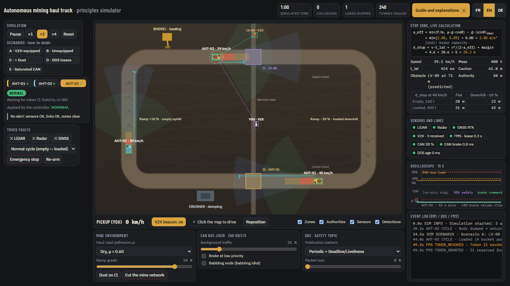

# aht-safety-poc

An interactive, single-page simulator that shows how an **Autonomous Haul Truck (AHT)** in an open-pit mine stays safe in mixed traffic: braking envelopes, fleet-management movement authority, CAN bus arbitration, DDS quality of service and an independent safety supervisor.

It is a teaching proof of concept. The physics is simplified but consistent: every number on screen is computed by the model.

> The user interface is available in French (default), English and German. Switch with the **FR / EN / DE** buttons in the header or with `?lang=en` / `?lang=de` in the URL; the choice is remembered in the browser. Technical terms, supervisor states, fault codes, DDS QoS names and standard references stay unchanged in every language. An in-app guide (button **Guide and explanations** or key **H**) explains every panel.

## Run it

No build, no dependencies. Open `index.html` in a recent browser, or serve the repository with GitHub Pages (Settings → Pages → deploy from branch `main`, folder `/`).

The page loads Google Fonts if online and falls back to system fonts otherwise.

## What you can explore

| Topic | What the simulator shows |
|---|---|
| Braking envelope | Each truck projects an amber caution zone and a red SIL stop zone along its path, recomputed every 20 ms from speed, mass, grade, road adhesion and latency. |
| Mass effect | Empty, the truck is adhesion-limited and mass cancels out; loaded, it is brake-capacity-limited. Loaded and downhill is the sizing case. |
| Movement authority | The fleet management system (FMS) grants each truck a stretch of road and intersection tokens. A truck never drives beyond its authority. |
| Mixed traffic | You drive a maintenance pickup (ZQSD or arrow keys), with or without a V2X beacon, and cut in front of the trucks. |
| Fail-operational | With the LiDAR blinded by dust, the truck falls back on radar and continues at 15 km/h. |
| CAN bus (J1939) | Priority arbitration keeps a well-prioritised brake command fast under load; a mis-prioritised one misses its deadline, then trips the brake ECU watchdog. |
| DDS QoS | Periodic state with Deadline and Liveliness versus event-driven RELIABLE or BEST_EFFORT, under packet loss. |
| Safety supervisor | State machine `NOMINAL` → `DEGRADED_SPEED` → `CONTROLLED_STOP` → `EMERGENCY_BRAKE` (latched until acknowledged), with the state actually applied by the motion controller shown separately. |

### Built-in scenarios

| | Scenario | Expected outcome |
|---|---|---|
| A | Pickup **with** V2X crosses intersection I1 | The FMS revokes the truck's I1 token; the truck makes a planned stop before the intersection. |
| B | Pickup **without** V2X crosses I1 | Only on-board perception protects; trajectory prediction slows the truck early. |
| C | B inside a dust cloud | LiDAR lost, radar fallback, degraded speed, mission continues. |
| D | Stop command sent once in BEST_EFFORT with 50 % loss | The order can be lost silently and a collision can occur. Switch to periodic publishing to compare. |
| E | Saturated CAN bus, brake command mis-prioritised | Deadline missed → controlled stop; push the load towards 90 % → watchdog → emergency brake. |

## Modelling choices

- **Stopping distance:** `d_stop = v·t_lat + v² / (2·a_eff) + margin`, with `a_eff = min(F_brake/m, μ·g·cosθ) − g·sinθ`. Keeping the two limits separate is what makes mass matter.
- **Stop zone and braking:** the red zone uses maximum deceleration, so an intrusion triggers maximum modulated braking; the amber zone uses a comfortable deceleration.
- **CAN load is a design budget, not a runtime safety criterion.** The usual 40 % rule comes from response-time analysis. At runtime what matters is the brake command latency against its deadline.
- **Safety commands over DDS** are published periodically with Deadline and Liveliness, and the receiver goes to a safe state on silence (black-channel principle, IEC 61784-3). RELIABLE guarantees delivery, not timeliness.
- **ROS 2 / DDS do not carry the safety integrity level.** Safety lives in an independent supervisor (doer/checker pattern) and in actuator watchdogs: the planner avoids the zones, the supervisor checks them.
- **Loss of the FMS link** leads to a planned stop inside the authority already granted, not to an emergency stop.
- **Unequipped vehicles are a degraded case:** in operation every vehicle entering the autonomous zone carries a terminal; on-board perception is the last barrier.
- **Emergency state is latched** and needs an explicit acknowledgement before the truck can move again.

## Code structure

Everything lives in `index.html` (vanilla JavaScript, HTML5 canvas, no framework). The script is split into four modules:

1. **MineWorld & PhysicsEngine:** haul road graph, grades, longitudinal dynamics with traction, braking and adhesion limits.
2. **EmbeddedCommsBus:** CAN response-time model per priority class, DDS safety topic with loss, retransmission, Deadline and Liveliness.
3. **AutonomyAndSafetyCore:** perception (LiDAR, radar, V2X), FMS tokens and movement authority, planner, safety supervisor, motion controller.
4. **FaultInjector & TelemetryHUD:** scenarios, fault injection, pickup driving, telemetry panels, oscilloscope and event log.

Physics runs at a fixed 50 Hz step, decoupled from rendering.

An I18N block at the top of the script holds the translations. French static text stays in the HTML (`data-i18n*` attributes) with English and German in `STATIC`; dynamic messages are `[fr, en, de]` triplets in `MSG`. Log entries and supervisor reasons are stored as message keys with parameters and translated at display time, so switching language also re-translates the event history.

## Limitations

- Perfect path following (no lateral Ackermann control); reversing manoeuvres at the shovel are not simulated.
- Perception without false positives; constant-velocity prediction over 6 s; a single forward radar of ±18°.
- Generic, plausible orders of magnitude (160 → 400 t, 1.15 MN braking force, 2.6 MW traction, 2 % rolling resistance). They do not describe any specific truck.
- CAN response time approximated by `C + U·20 ms / (1 − U)` for synchronised bursty traffic; DDS RELIABLE retransmits every 30 ms.

## References

- IEC 61508 (functional safety), ISO 19014 (earth-moving machinery functional safety), ISO 17757 (autonomous machine system safety)
- [ISO 23725:2024](https://www.iso.org/standard/76769.html), autonomous system and fleet management system interoperability
- [ISO 21815-1:2022](https://www.iso.org/standard/77302.html), earth-moving machinery collision warning and avoidance
- [US patent 10140871](https://image-ppubs.uspto.gov/dirsearch-public/print/downloadPdf/10140871), travel-permitted zones set by the fleet operations server
- [US patent 9672743](https://image-ppubs.uspto.gov/dirsearch-public/print/downloadPdf/9672743), stopping within the permitted section on communication loss
- [WorkSafe WA, Mines Safety Significant Incident Report No. 286](https://worksafe.wa.gov.au/publications/mines-safety-significant-incident-report-no-286-near-miss-following-unplanned-movement), unplanned movement of autonomous haul trucks

## Disclaimer

This is an educational model. It is not a safety tool, it has not been validated against any standard, and it is not affiliated with or endorsed by any equipment manufacturer or mining company. Do not use it to design or assess a real system.

Developed with the assistance of Claude (Anthropic).

## License

[MIT](LICENSE) © 2026 Jean-Luc Rominger
